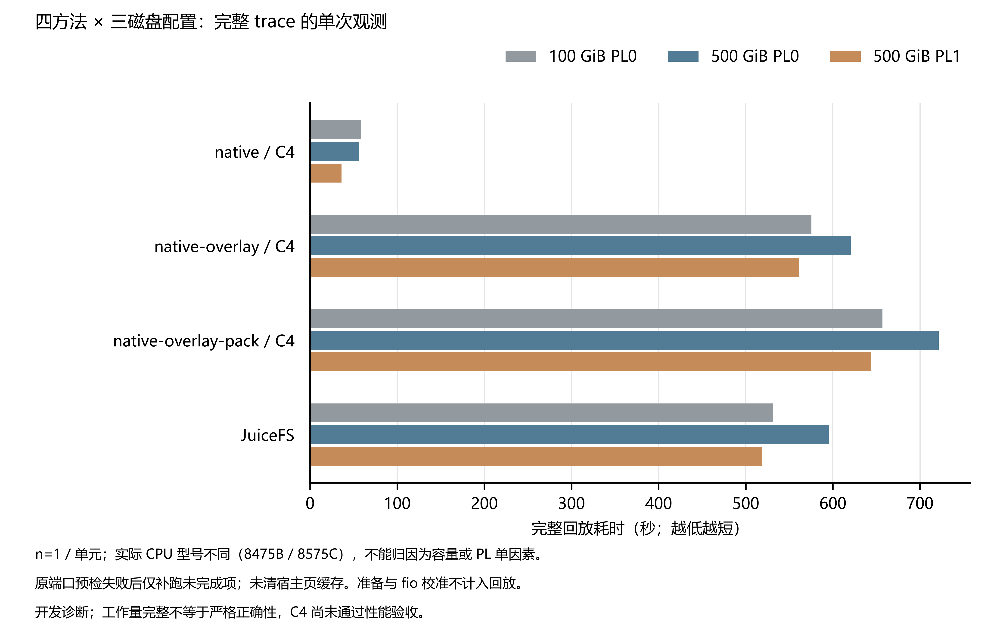

本图只展示三台新实例四方法的完整回放，**开发诊断，C4 尚未通过性能验收**。

| 方法 | 100 GiB PL0（秒） | 500 GiB PL0（秒） | 500 GiB PL1（秒） |
|---|---:|---:|---:|
| native / C4 | 58.398 | 55.970 | 36.185 |
| native-overlay / C4 | 575.414 | 620.678 | 561.169 |
| native-overlay-pack / C4 | 656.928 | 721.601 | 644.369 |
| JuiceFS | 531.587 | 595.309 | 518.697 |

fio 独立校准（每格为 IOPS / MiB·s⁻¹，60 秒 direct I/O；不计入上图）：

| 项目 | 100 GiB PL0 | 500 GiB PL0 | 500 GiB PL1 |
|---|---:|---:|---:|
| 4 KiB 随机读 QD32 | 3053.2 / 11.93 | 7932.5 / 30.99 | 27251.5 / 106.45 |
| 4 KiB 随机写 QD32 | 3014.1 / 11.77 | 7837.2 / 30.61 | 26931.7 / 105.20 |
| 1 MiB 顺序读 | 127.2 / 127.24 | 183.0 / 183.05 | 356.0 / 355.97 |
| 1 MiB 顺序写 | 125.6 / 125.61 | 180.9 / 180.90 | 351.7 / 351.70 |
| 4 KiB 同步写 | 2316.8 / 9.05 | 2310.6 / 9.03 | 12256.4 / 47.88 |

16 GiB 预填充依配置顺序为 130.307 / 90.311 / 46.079 秒，单列准备成本。

[校准与观测摘要](calibration-observation.json) · [校准原值 CSV](calibration.csv)。clat p99 不是总延迟；原 fio 未采总延迟分位，保留 null。API Throughput 的 MB/s 标签不冒充实测 MiB/s。

pack／snapshot fixture 构建与上传合并计时依配置顺序为 3.651 / 3.732 / 3.497 秒，不能进一步拆分；主图仅含回放。12 项观察器自测 CPU 占单核 0.36%–0.52%，这是开销记账，不是开关观察器的因果对照。

各节点 packed 相对 overlay 的 Redis 命令计数减少 38.7%–40.3%，回放耗时却增加 14.2%–16.3%。这里使用 Redis instance 的 `total_commands_processed` 前后差，包含监测和其他命令；不能当成单类元数据请求数或缓存因果收益。

每项均完成 1,747,109 ops，read 281,774,624 B／write 194,706,661 B，剩余句柄 0，回放及自然挂载退出 0。保留 expected errors 与 probe errno 差异，performance mode 不证明严格正确性。

三节点均为 ecs.g8i.2xlarge；实际 CPU：100g-pl0 = Intel(R) Xeon(R) Platinum 8575C；500g-pl0 = Intel(R) Xeon(R) Platinum 8475B；500g-pl1 = Intel(R) Xeon(R) Platinum 8575C。n=1、宿主型号混杂、顺序执行和未清宿主页缓存限制了容量／PL 因果解释。

原 attempt 在 packed 启动前发生端口预检错误；原失败记录保留。仅 packed 与 JuiceFS 在同实例新后端和目录补跑，恢复间隔不计入回放。观察日志都在系统盘；host 身份采集发生在测量开始后，loadavg 不是初始负载。

[原始回放数据](source-data.csv) · [准备阶段命令耗时](preparation.csv) · [证据与 SHA](provenance.json)。pack／snapshot fixture 构建上传若为合并计时就不能进一步拆分；本组没有验证在线 freeze／fork／迁移。

fio 校准独立于 trace，16 GiB 预填充与五项 60 秒直接 I/O 测量单列；校准与观测摘要另附。资源状态：100g-pl0 已核验实例／两盘／安全组／临时桶释放；500g-pl0 已核验实例／两盘／安全组／临时桶释放；500g-pl1 为额外 baseline-overlay 验证显式保留，尚未释放。共享网络由根任务单独管理。
