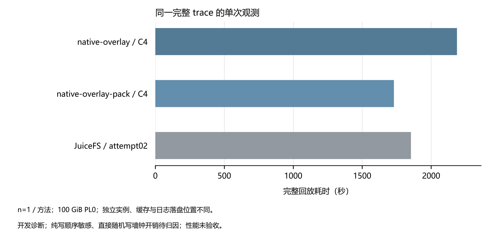

# 完整 AI trace 回放测试摘要

三种最终方法均完成同一条 trace 的 1,747,109 次操作，读取 281,774,624 B、写入 194,706,661 B，剩余句柄 0、回放退出码 0，未超时。对应实例、创建磁盘、安全组和临时桶均已核验释放。

**纯写对顺序敏感，直接随机写额外墙钟开销待归因，候选尚未通过性能验收。** 首轮 randrw 吞吐与 completion p99 改善，但 seqwrite 约回退 25%、randwrite direct=1 回退 64.3%；反向复测 seqwrite 方向翻转、buffered randwrite 差异幅度变化。直接随机写 active 吞吐接近，tool-wall 吞吐仍低 15.4%（115.520 对 136.571 MiB/s）。 命令成功不等于没有性能回退。

每方法仅一次串行 performance 回放（n=1）；不同实例与缓存配置下的耗时观测不构成公平排名、加速比或严格正确性证明。

| 方法 | 完整耗时（s） | 预期错误 | probe errno 差异 | 退出：回放/卸载/挂载 | 原始 valid | 数据 |
|---|---:|---:|---:|---|---|---|
| native-overlay / C4 | 2,187.17 | 45,525 | 1,048 | 0/0/0（挂载自然退出） | false | [结果 JSON](../native-overlay/candidate4.json) |
| native-overlay-pack / C4 | 1,730.24 | 45,525 | 1,048 | 0/0/0（挂载自然退出） | false | [结果 JSON](../native-overlay-pack/candidate4.json) |
| JuiceFS / attempt02 | 1,853.92 | 45,525 | 0 | 0/未记录/未记录 | false | [结果 JSON](../juicefs/result.json) |

工作量完整与字节数一致只验证回放完整性；预期错误和 probe errno 差异按原报告保留。未做严格最终状态认证。

| 方法 | 实例与缓存配置 | 回放前准备（s） |
|---|---|---|
| native-overlay / C4 | ecs.e-c1m4.2xlarge；8 vCPU / 32 GiB；读/写内存各 256 MiB、读/写 SSD 各 512 MiB；元数据 open TTL/容量及 FUSE TTL 为 0；未清宿主页缓存，日志在系统盘 | 卷初始化：0.03；初始数据复制：22.42；另有建桶与准备卸载记录；后台启动、归档解包、挂载就绪未单独计时，无法给出完整准备总计；不是 fork/迁移。 |
| native-overlay-pack / C4 | ecs.e-c1m4.2xlarge；8 vCPU / 32 GiB；读/写内存各 256 MiB、读/写 SSD 各 512 MiB；元数据 open TTL/容量及 FUSE TTL 为 0；日志在数据盘 | 准备总计：8.38；snapshot fixture 构建+上传：7.81；总计含源码复制、建桶、初始化和挂载就绪；fixture 构建/上传未单独拆分，就绪采用 250 ms 轮询；不是在线 freeze/fork。 |
| JuiceFS / attempt02 | ecs.e-c1m4.2xlarge；8 vCPU / 32 GiB；客户端缓存 512 MiB，buffer 512 MiB，元数据 TTL 0；复用经历中断的实例，未清宿主页缓存 | 未记录，无法拆分；原摘要说明准备时间不计入回放，但未给出阶段耗时，无法拆分。 |

本轮三种配置均为 100 GiB ESSD PL0 数据盘与 40 GiB 系统盘。设容量 C 的单位为 GiB，PL0 的理论 IOPS = min(1800 + 12C, 10000)，理论吞吐 = min(100 + 0.25C, 180) MB/s；100 GiB 对应 3,000 IOPS、125 MB/s。[阿里云 ESSD 规格](https://help.aliyun.com/zh/ecs/user-guide/essds)

ecs.e-c1m4.2xlarge 的全盘合计上限为 16,000 IOPS、0.8 Gbit/s（约 100 MB/s），数据盘与系统盘共享这一额度。因此磁盘标称值不能单独代表实例可达值；这些是理论限制，不能据此认定本次观测已触顶。[e 实例规格](https://help.aliyun.com/zh/ecs/user-guide/shared-instance-families) · [实例存储 I/O 限制](https://help.aliyun.com/zh/ecs/user-guide/storage-i-or-o-performance)

观测日志落盘位置也不一致：packed 写入数据盘 /data/results，native-overlay 写入系统盘 /var/log/ax-trace，JuiceFS 也写入系统盘。这会改变观测器与被测工作负载的磁盘竞争关系；结合实例、缓存与准备状态的差异，本轮只作单 trace、单次开发诊断，不能严谨归因软件差异。

固定版本的 pack／snapshot fixture 构建、上传和挂载等准备阶段与图中的纯回放耗时分开。未记录的阶段不由总时间相减估算；这些准备不是在线 freeze/fork/迁移测试，多 agent fork/迁移实验尚未完成。

修复与验证：目录 cookie 仅随命名空间提交与显式视图替换失效，数据／属性写入及已删除名称的孤儿 inode 回收不再改变目录代次；native overlay 仅在显式有效独占租约下使用行缓存；取消或结果不确定的提交永久关闭本挂载的相关缓存权威；命名空间提交不确定后退回远端版本校验。
C4 本地 CI 与源码差异检查全部通过，包含完整 workspace test；compose 已完整执行，原始命令／检查 passed=true，性能验收与之分开记录。源码归档 `d609a429dfce` 与两次 C4 回放一致。[CI、compose 原始结果与修复证据](../reporting/acceptance-evidence.json)。

| 方法 | 观测器 CPU（s） | 单核占用（%） | 观测器峰值 RSS（MiB） | 上传器 CPU（s） | 费用估算（元） |
|---|---:|---:|---:|---:|---:|
| native-overlay / C4 | 未记录 | 未记录 | 未记录 | 1.98 | 0.9528 |
| native-overlay-pack / C4 | 10.48 | 0.61 | 394.24 | 10.07 | 0.9120 |
| JuiceFS / attempt02 | 13.91 | 0.75 | 98.45 | 3.43 | 0.3799 |

观测器和上传器的 CPU/RSS 是资源观测，不等于对回放延迟的影响；未做关闭观测器的成对试验。费用为记录中的估算，不是账单，不补算缺失项。
费用范围：This one shared instance: C1, history probe, preparation, waiting for the final build, and C4. Count the group total once.；Entire owned environment including superseded builds, diagnostics, waiting and final replay; not replay-only cost.；estimate, not a bill; excludes traffic and OSS, spot price may change。
释放证据：[native-overlay / C4](../native-overlay/candidate4.json)、[native-overlay-pack / C4](../native-overlay-pack/candidate4.json)、[JuiceFS / attempt02](../juicefs/result.json)。
本地临时构建 swap 也已核验停用并删除；该记录独立于各云端实例释放。
保留的额外警告：native-overlay / C4：GC metadata-budget 警告 49 次；native-overlay-pack / C4：GC metadata-budget 警告 35 次。

历史排除仅包括原 packed EBUSY／早期超时、JuiceFS 系统重启中断及 C1 版本差异；旧候选与故障注入只作诊断／回归证据，不计入最终耗时。详细记录：[历史失败／超时与候选排除](../reporting/history-exclusions.json)、[native-overlay / C1](../native-overlay/candidate1.json)、[C1 中断写探针](../native-overlay/candidate1-interrupted-write.json)、[JuiceFS / attempt01](../juicefs/interruption.json)。

限制：单 trace、每方法单次串行开发诊断，不重放原进程调度或本地锁；fixture 构建／上传是固定版本准备，不等于在线 freeze/fork/迁移测试；多 agent fork/迁移实验尚未完成；未做观测器关闭对照，无法量化采样对延迟的因果影响；不能据此断言先前长生命周期进程或 WSL 状态导致的挂起已被定位或彻底修复。

[源数据 CSV](source-data.csv) · [可编辑 SVG](replay-seconds.svg) · [PDF](replay-seconds.pdf) · [输入与输出哈希](provenance.json)
