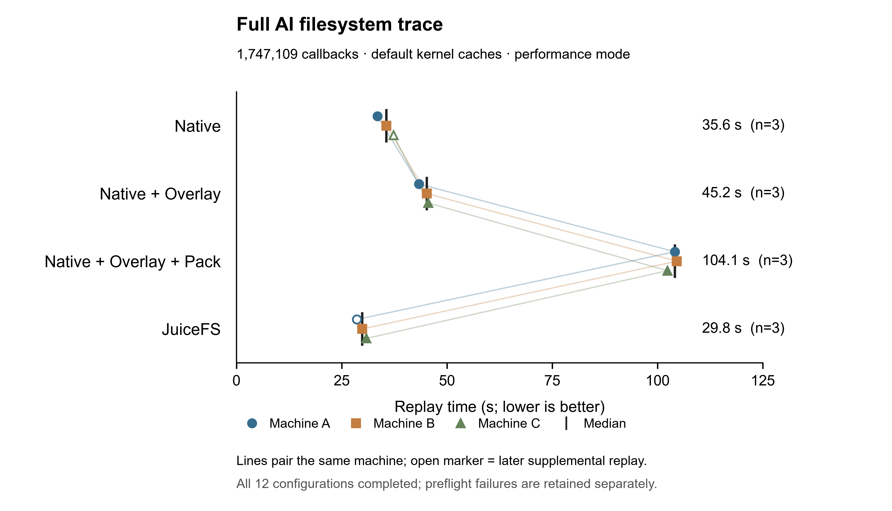

# BrewFS 主分支 AI trace：三机结果

已保全全部 12 个成功回放，每方法在 A/B/C 各测量一次。A 的 JuiceFS 与 C 的 Native 在主矩阵后独立补测；4 条未产生回放的 Git 预检失败记录保留，不赋予零耗时。补测有独立运行标识和目录，未覆盖原失败，也未重跑已完成测量。

| 方法 | 成功测量数 | 中位数（秒） | 最小–最大（秒） |
|---|---:|---:|---:|
| Native | 3 | 35.611 | 33.472–37.334 |
| Native + Overlay | 3 | 45.201 | 43.361–45.536 |
| Native + Overlay + Pack | 3 | 104.144 | 102.368–104.581 |
| JuiceFS | 3 | 29.847 | 28.599–30.871 |

计时取 Rust 回放器的 execution_seconds，不把 Git 核验、格式化、打包和挂载准备算成回放耗时。每个成功测量均完成 1,747,109 个操作，实际读 281,774,624 B、写 194,706,661 B，剩余句柄为零。图上的点表示机器 A/B/C，连线表示同一机器，黑线表示中位数；空心点为后续补测。每机每方法仅选一个成功测量，完整汇总拒绝重复成功中的择优选择。

在三台机器内分别配对，Overlay/Native 的耗时比中位数为 1.269，Pack/Native 为 2.937，JuiceFS/Native 为 0.838。当前这条 trace 下，Native 的耗时低于 Overlay 与 Pack；JuiceFS 的回放更短。每机每方法只有一次测量，且两项补测晚于主矩阵，存在运行顺序和时间差异。这组观测不能外推到海量小文件、多消费者复用或元数据数据库存在竞争的场景。

Pack 的静态基线构建、上传与发布另耗时 3.585–3.646 秒，静态源目录复制约 0.018–0.019 秒；它们未混入上表。这里使用已静止的文件树，在线元数据数据库的冻结成本尚未测量。Pack 的元数据中心卸压、共享复用收益，以及动态块、fork 和迁移，仍需对应的独立实验。

三台机器均为 8 vCPU、32 GiB、500 GiB PL1 云盘；每机独立本地后端，属于配对区组。客户端限制 4 CPU/8 GiB，RustFS 2 CPU/16 GiB，Redis 1 CPU/2 GiB；使用产品默认内核缓存、无压缩和既定持久性配置。本轮保留真实 trace 的全部操作及 xattr，回放无总时限。

这是性能模式，不声明严格正确性通过。BrewFS 三方法各测量的 probe_errno_differences 为 1048，JuiceFS 为 0；原始诊断字段保留在汇总中。A JuiceFS 原失败、C Native 原失败以及 C 的前两次补测尝试，均发生在 Git 预检、实际回放之前。准备链路修复仅将私网代理 CONNECT 建连预算从 30 秒延至 120 秒，经独立复审和 107 项测试；TLS 校验、冻结回放器及实验参数未改。C 的第三次补测尝试首次进入实际 Native 回放，耗时 37.33372829 秒。首次全组准备失败的归档也单独保留，未作为性能观测。

BrewFS 源码为 350dc108a3bffcb5e7e27cc4279dfb5729febe60；RustFS 使用 feat/dynamic-block-size-rebased 的 a87e8f94a50b9fb6e3da74fed45fe37d4cb969ed；冻结实验 driver 为 8e815bd91060bae90a2699668cc5d87e32b2e4c1。各机器复用已核验的同一套二进制与镜像。

[JSON 汇总](summary.json) 和 [CSV 汇总](summary.csv) 保留全部 16 行及来源归档 SHA；其中 12 行用于图，另 4 行预检失败保留且不赋予性能值。归档只对日志中的临时凭据作脱敏，性能指标保持不变并校验哈希。[绘图脚本](plot_performance.py) 可复现 PNG、SVG 与 PDF；需要 Python 和 Matplotlib。示例：

    python plot_performance.py summary.json --output performance-comparison --qa-dir figure-qa

原始失败证据、完整归档、编译资产和图形 QA 保存在本轮本地运行记录中；未向 Git 提交私有配置或原始凭据。

2026-10-29（北京时间）已确认本轮云资源全部释放：3 台实例、6 块云盘、2 个自建安全组及规则、SSH keypair、临时桶和专用交换机；原有 VPC 与 trace 桶保留。完整结果、失败证据和已核验的统一编译资产留存在本地。安全组第一次删除遇到控制面依赖延迟，经只读确认没有外部依赖后，从同一精确清理入口恢复并确认释放。
