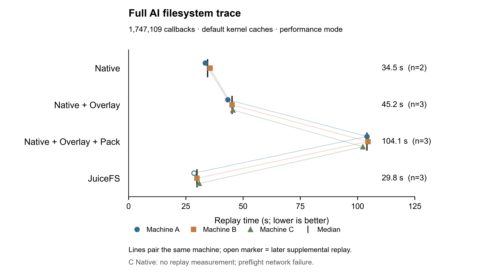

# BrewFS 主分支 AI trace：初步结果

已保全 11 个成功回放，另有 2 条原始 Git 预检失败记录。A 的 JuiceFS 已独立补跑完成；C 的 Native 尚未进入回放，等待用户选择是否补测。图中没有为缺失项填写零耗时。

| 方法 | 成功测量数 | 中位数（秒） | 最小–最大（秒） |
|---|---:|---:|---:|
| Native | 2 | 34.541 | 33.472–35.611 |
| Native + Overlay | 3 | 45.201 | 43.361–45.536 |
| Native + Overlay + Pack | 3 | 104.144 | 102.368–104.581 |
| JuiceFS | 3 | 29.847 | 28.599–30.871 |

计时取 Rust 回放器的 execution_seconds，不把 Git 核验、格式化、打包和挂载准备算成回放耗时。每个成功测量均完成 1,747,109 个操作，实际读 281,774,624 B、写 194,706,661 B，剩余句柄为零。图上的点表示机器 A/B/C，连线表示同一机器，黑线表示中位数；空心点为后续补跑。每机每方法仅选一个成功测量，完整汇总拒绝重复成功中的择优选择。

只对 Native 齐全的 A/B 做配对，Overlay/Native 的耗时比中位数为 1.282，Pack/Native 为 3.024，JuiceFS/Native 为 0.846。当前这条 trace 下，Native 的耗时低于 Overlay 与 Pack；已完成的 JuiceFS 回放更短。这组结果不能外推到海量小文件、多消费者复用或元数据数据库存在竞争的场景。

Pack 的静态基线构建、上传与发布另耗时 3.585–3.646 秒，静态源目录复制约 0.018–0.019 秒；它们未混入上表。这里使用已静止的文件树，在线元数据数据库的冻结成本尚未测量。Pack 的元数据中心卸压、共享复用收益，以及动态块、fork 和迁移，仍需对应的独立实验。

三台机器均为 8 vCPU、32 GiB、500 GiB PL1 云盘；每机独立本地后端，属于配对区组。客户端限制 4 CPU/8 GiB，RustFS 2 CPU/16 GiB，Redis 1 CPU/2 GiB；使用产品默认内核缓存、无压缩和既定持久性配置。本轮保留真实 trace 的全部操作及 xattr，回放无总时限。

这是性能模式，不声明严格正确性通过。BrewFS 三方法各测量的 probe_errno_differences 为 1048，JuiceFS 为 0；原始诊断字段保留在汇总中，不能隐藏这些差异。A JuiceFS 原失败和 C Native 原失败均发生在 Git 预检、实际回放之前。A 的补跑采用相同版本与资源配置、独立运行标识和目录，原失败行仍在数据中。

BrewFS 源码为 350dc108a3bffcb5e7e27cc4279dfb5729febe60；RustFS 使用 feat/dynamic-block-size-rebased 的 a87e8f94a50b9fb6e3da74fed45fe37d4cb969ed；冻结实验 driver 为 8e815bd91060bae90a2699668cc5d87e32b2e4c1。各机器复用已核验的同一套二进制与镜像。

[JSON 汇总](summary.json) 和 [CSV 汇总](summary.csv) 保留全部 13 行及来源归档 SHA；其中 11 行用于图，另 2 行原预检失败保留且不赋予性能值。归档只对日志中的临时凭据作脱敏，性能指标保持不变并校验哈希。[绘图脚本](plot_performance.py) 可复现 PNG、SVG 与 PDF；需要 Python 和 Matplotlib。示例：

    python plot_performance.py summary.json --output performance-comparison-preliminary --qa-dir figure-qa

原始失败证据、完整归档、编译资产和图形 QA 保存在本轮本地运行记录中；未向 Git 提交私有配置或原始凭据。

