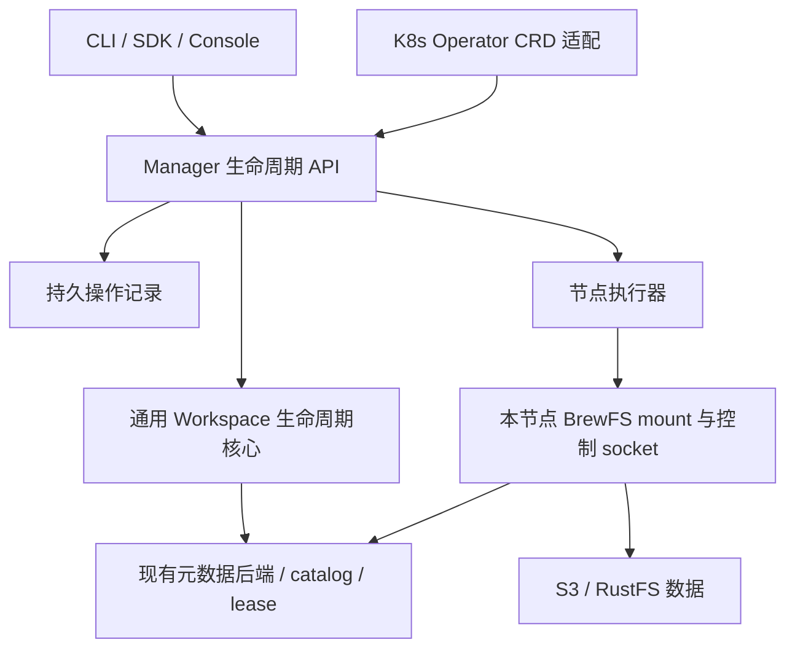

# BrewFS 无 Kubernetes 生命周期服务设计

状态：**P1 基础接口已由 [PR #390](https://github.com/brewfs/brewfs/pull/390) 合并；P2/P3 仍为设计，不启动实验或分配资源。** #390 仅支持单 Manager、本地 SQLite、`workspace-v1` 的卷初始化/登记、不可变 revision fork 和 lease 检查后的逻辑删除。实际路径、重试与完成判据见 [C1/C4 接入步骤](runbook/MANAGER.zh.md)，审查固定在合并提交 `1e7a95c10cbff8d34faf768ebd621ae8261cbd91`。这不代表当前共享服务池或两节点交接已可用。

下文的原有能力盘点和源码链接保留设计时基线 `80ddaf739e163c8933b0bb84390c4aa559bd2b40`，不作为当前实现清单。规模、baseline、机器预算仍以 [PLAN](PLAN.zh.md)、[HARDWARE](HARDWARE.zh.md) 为准。

## 1. 已有能力与缺口

| 已有实现 | 实际能力 | 需要补什么 |
|---|---|---|
| [Console HTTP 路由](https://github.com/brewfs/brewfs/blob/80ddaf739e163c8933b0bb84390c4aa559bd2b40/src/console/server.rs#L13) | 独立 HTTP 服务、鉴权、卷配置、文件/ACL/回收站、本机实例；CSI 是可选集成 | workspace 生命周期 API、跨节点执行和持久操作状态 |
| [Console 卷登记](https://github.com/brewfs/brewfs/blob/80ddaf739e163c8933b0bb84390c4aa559bd2b40/src/console/registry.rs#L16) | `volumes.json` 保存配置；创建/删除的是登记记录 | 区分登记、初始化真实卷、删除工作区和回收对象，不能把登记成功当成 FS 创建成功 |
| [WorkspaceLifecycle](https://github.com/brewfs/brewfs/blob/80ddaf739e163c8933b0bb84390c4aa559bd2b40/src/workspace_overlay/lifecycle/mod.rs#L31) | 基于 WorkspaceStore 的 fork、discard、mount lease | 复用存储原语；增加远程请求的幂等、逐项进度与失败恢复 |
| [Operator WorkspaceAdmin](https://github.com/brewfs/brewfs/blob/80ddaf739e163c8933b0bb84390c4aa559bd2b40/operator/brewfs-operator/src/workspace/admin.rs#L191) | 卷、workspace、snapshot 的管理 facade；控制器接 K8s 资源 | 将通用接口/实现移出 operator，K8s 类型转换、Pod/Secret/finalizer 留在适配层 |
| [本机控制协议](https://github.com/brewfs/brewfs/blob/80ddaf739e163c8933b0bb84390c4aa559bd2b40/src/control/protocol.rs) | Unix socket 上的实例查询、GC、文件等操作 | 增加按 workspace/attachment 定位的 drain/安全卸载，提供版本与能力协商 |

当前 CLI 的 [fork](https://github.com/brewfs/brewfs/blob/80ddaf739e163c8933b0bb84390c4aa559bd2b40/src/config.rs#L492) 从**精确的不可变 revision** 派生，不会自动封存活跃 workspace。新接口不能把“在线任意时刻 fork”作为已有能力。`workspace migrate` 是目录格式迁移，不是 Agent 跨节点交接。

## 2. 分层与部署

建议复用现有 Console 的 HTTP/鉴权基础，加入可独立、无前端运行的 **BrewFS Manager**。产品实现放 BrewFS 仓库，实验仓库只放调用与核验脚本。

- **Manager** 管理卷登记/初始化、revision、fork、attachment、操作进度、回收请求。文件读写直接走客户端与元数据/S3，Manager 不转发数据。
- **节点执行器** 每个执行节点部署一个，执行受限的 mount/drain/unmount，报告实际版本、进程、挂载与写者身份。Docker 必须定位正确 mount namespace；挂载点验证只允许本轮配置的根目录。接口不接受任意 shell 命令。
- **挂载执行只选一种适配器**：裸机/普通 Docker 使用节点执行器，K8s 使用 Pod/CSI 适配器；同一 attachment 不由两者重复创建或卸载。已有 CSI 生命周期需映射到同一操作记录和 lease 规则。
- **Operator** 保留 CRD、Pod/CSI、Secret、调度与 finalizer 的 K8s 适配职责。目标是通过统一 API 提交操作、将进度映射到 CRD status；提取通用核心时先保持现有行为。一个卷命名空间必须明确由旧控制器或 Manager 接管，不能两套控制循环同时管理。
- **无 K8s**：Manager 可用 systemd 或 Docker，节点执行器用 systemd 或受控容器；执行节点复用相同 API。阿里云与自备服务器仅资源接入不同。初期可在已有管理节点部署，单独限额并测资源余量，不默认增购机器。
- **持久性**：MVP 采用单 Manager、持久盘上的事务操作日志（可用 SQLite）；文件系统 catalog/lease 仍以原元数据后端为权威。控制日志和 catalog 跨存储不假定原子提交，必须按预先记录的资源 ID 对账恢复。多副本/选主不属于第一阶段，不能在共享 SQLite 文件上直接开多个 Manager。
- **访问控制**：沿用 Console 鉴权并增加卷/操作权限范围；跨机使用 TLS 和受限节点身份。持久记录只存凭据引用，不在 API 返回、事件或日志暴露密钥。

Kubernetes Operator 本身是基于 K8s 自定义资源和控制循环的扩展；可移植的生命周期语义应放在它下层，而不是要求裸机运行 K8s 才能 fork。[官方定义](https://kubernetes.io/docs/concepts/extend-kubernetes/operator/)

## 3. 建议的接口合同

以下 `/api/v1` 路径是**完整目标合同，不是已实现 API 清单**。#390 已实现的子集及路径以 [MANAGER](runbook/MANAGER.zh.md) 为准，例如实际 fork 是 `POST /api/v1/volumes/{id}/forks`；Node、Attachment、checkpoint、drain、handoff 尚未实现。不能把本表直接写入执行 prompt。目标资源为 Volume、Workspace、Revision、Node、Attachment、Operation。卷身份必须包含真实 catalog 身份；Attachment 用全局 ID＋node ID＋boot ID＋写者 generation，不能用 PID 作为跨机身份。

| 操作 | 建议 API | 完成条件 |
|---|---|---|
| 版本/能力 | `GET /api/v1/capabilities`、`GET /api/v1/nodes` | 分别返回服务端和节点的版本、格式、后端、上传策略、drain/交接能力；只用两端兼容交集 |
| 卷接入 | `POST /api/v1/volumes`，明确 `register` / `initialize`；`GET /api/v1/volumes/{id}` | register 校验已有 catalog；initialize 显式限定空命名空间并完成初始化；不覆盖已有卷 |
| workspace 创建/查询 | `POST /api/v1/volumes/{id}/workspaces`；`GET /api/v1/workspaces/{id}` | 已持久创建并能按 ID 查询，返回 base revision、head epoch 和 lease；列表分页 |
| 从 revision fork | `POST /api/v1/revisions/{id}/forks` | 指定不可变源、数量和 owner；每个子 workspace 单独返回 ID/状态；不默认挂载 |
| 活跃源的 checkpoint | `POST /api/v1/workspaces/{id}/checkpoints` | 应用先停止写入；再按该格式支持的 drain/冻结/发布原语产生精确 revision。未实现或不支持时明确拒绝 |
| 挂载/查询 | `POST /api/v1/workspaces/{id}/attachments`；`GET /api/v1/attachments/{id}` | lease 获准、真实 FUSE 挂载就绪且就绪探测成功，返回实际生效配置 |
| 写回排空 | `POST /api/v1/attachments/{id}/drain` | 返回目标写入边界和经客户端验证的 remote-ready 回执；不是单次读取队列为 0 |
| 安全卸载 | `POST /api/v1/attachments/{id}/detach` | 停止业务写者、排空目标数据、卸载、释放相应 lease；每阶段有证据 |
| 有序交接 | `POST /api/v1/workspaces/{id}/handoffs` | 指定源 attachment、目标 node、预期 generation；源安全释放后目标挂载就绪。应用会话恢复另外计时 |
| 删除/回收 | `DELETE /api/v1/workspaces/{id}`，返回 operation | 先标记删除，检查 attachment、revision 引用及子工作区依赖；物理回收另报。默认不强制 fencing/删除共享 lower |
| 操作查询 | `GET /api/v1/operations/{id}` | 返回阶段、资源 ID、部分结果、错误、重试条件、持久事件与时间；请求超时后仍可查询 |

所有有副作用的请求带作用域内 `Idempotency-Key`；同 key＋同规范化请求返回同 operation，不同请求返回冲突。服务端在副作用前持久化目标资源 ID；失联后核实际状态，不能换 ID 重做。需要并发保护的操作带 `expected_generation`/revision，冲突明确返回。`202 Accepted` 只表示已持久接收，不表示文件系统已就绪。

批量 fork 必须报告逐项结果并支持按原 ID 续作，不能把部分成功冒充原子批次。[当前 fork 循环](https://github.com/brewfs/brewfs/blob/80ddaf739e163c8933b0bb84390c4aa559bd2b40/src/workspace_overlay/lifecycle/mod.rs#L63) 逐次生成随机 ID；不能仅在它外面套 HTTP 重试。需复用 WorkspaceStore 原语，在通用核心增加由操作记录指定 ID 的创建路径。当前 [JobManager](https://github.com/brewfs/brewfs/blob/80ddaf739e163c8933b0bb84390c4aa559bd2b40/src/control/job.rs#L42) 的内存 DashMap 也不能直接承担跨重启操作日志。

## 4. 完成边界与失效处理

每个操作暴露阶段和结构化失败原因；区分 `Accepted`、`Running`、`Succeeded`、`Failed`、`RecoveryRequired`。资源另报 `metadata_ready`、`remote_ready`、`mounted`，不能压成一个通用 Ready。fork 成功不代表已挂载；删除成功也需说明是逻辑删除还是对象已回收。

有序交接流程：**应用到工具边界并停写 → 记录 checkpoint/目标写入边界 → drain 至远端可恢复 → 卸载源并释放写者 → 目标获取新 generation 并挂载 → 应用恢复并核对**。Manager 管文件系统阶段；OpenCode session/HOME/XDG 的导出、导入、任务续跑由 [迁移适配器](runbook/MIGRATION.zh.md) 负责，不声称进程内存、打开 FD 或执行中工具能够迁移。

- **异步上传**：`commit_before_upload` 的应用完成不等于远端完成。drain 回执至少绑定 workspace、attachment、head/写入边界、writer generation、策略和持久失败项；对应数据、元数据发布均完成才标 remote-ready。当前 [pending_writeback_bytes](https://github.com/brewfs/brewfs/blob/80ddaf739e163c8933b0bb84390c4aa559bd2b40/src/workspace_overlay/control.rs#L104) 来自最新 seal journal、缺日志时为 0，不能作为实时上传队列或安全交接证明。
- **能力必须真实**：本次所核对的 [配置校验](https://github.com/brewfs/brewfs/blob/80ddaf739e163c8933b0bb84390c4aa559bd2b40/src/config.rs#L1275) 仍要求 `workspace-native-v2` 使用 `upload_before_commit`。待开发的 writeback 能力不得预先宣称可用；不同格式的 clean-release 证明不能互换。
- **双写保护**：所有变更继续服从原有 metadata lease/generation 的 fencing。节点心跳丢失或 lease 超时，不等于旧客户端已停止，也不证明本地待上传数据已保全。无法验证时进入 RecoveryRequired；MVP 不提供失联源的自动强制交接。
- **故障恢复**：Manager 重启后恢复原 operation；节点重启按 boot ID 拒绝旧 ACK。完成状态以实际 catalog/lease、节点回执对账；超时不擅自推断操作没发生。失败保留源 staging 和必要恢复信息，不在通用清理中删掉。
- **可用性**：Manager 暂停应使新生命周期操作等待/报错，已有 mount 仍直接连接原元数据/S3 并续租；此隔离需要故障测试证明，不能由架构图推断已经做到。

## 5. 实施与实验接入

| 阶段 | 交付 | 验收 |
|---|---|---|
| P1 通用核心与持久操作 | 提取 WorkspaceAdmin 的平台无关部分；能力查询、卷接入、不可变 revision fork、检查、删除；HTTP/CLI 共用语义 | 同 key 重试不增殖；请求冲突；批量部分失败；元数据成功但 ACK 丢失；服务重启恢复；引用保护；K8s 既有用例无回归 |
| P2 节点管理 | 节点执行器、attachment、目标边界 drain、安全 detach | 两台真实 Linux 节点；mount namespace/进程核对；旧 generation/旧 boot ACK 被拒绝；失败保留 staging；控制服务重启不破坏已有 I/O |
| P3 交接与规模 | 有序 handoff；Operator 接同一生命周期接口；并发限流与观测 | 先 2 节点 stay/move，再 64/128 个独立 workspace 的创建/挂载突发；部分失败可追踪，无重复资源/双写；另记录管理服务 CPU、内存、排队、p95/p99 |

**C1** 的生命周期准备与清理放在文件系统负载计时外；固定两臂协调器资源，Manager 作为 BrewFS 产品资源单独核算，不让 JuiceFS 安装无关服务。现有直接 CLI 准备路径可继续做资格，不必等待整个 Manager 完工。性能矩阵、Pack 的只读范围和上传策略配对不改。

**C4 fork** 同时报告 API 接收→元数据创建完成、首次挂载/首用、drain/远端确认，不能拿 BrewFS 的 202 响应与 JuiceFS clone 的完成时刻比较。**C4 handoff** 用同一协调器时钟报告应用停写、排空、释放、目标就绪和首条正确工具的分段 ACK；BrewFS/JuiceFS 均保留 stay/move 配对，写回模式配对，迁移子集之外任务继续运行。

JuiceFS 继续调用其原生 clone/mount/排空机制，由实验仓库提供薄适配；Manager 是 BrewFS 产品组件，不需要让 JuiceFS 伪装成 BrewFS workspace。两种路径采用相同请求发起/完成观测边界、资源核算和验收条件。控制面耗时与文件系统核心耗时分别报告，外部模型/AI 监督等待不混进计时。

已有执行工具见 [SCALE-RUN](runbook/SCALE-RUN.zh.md)、[迁移步骤](runbook/MIGRATION.zh.md)；#390 的独立 API 调用与 C1/C4 接入见 [MANAGER](runbook/MANAGER.zh.md)。**当前正式后端接入与两节点资格仍未通过，不把 planning 状态改成 ready。** 后续只增加每步调用/核对的小脚本，不写自动购机、跑完整矩阵并删除资源的一体脚本。
