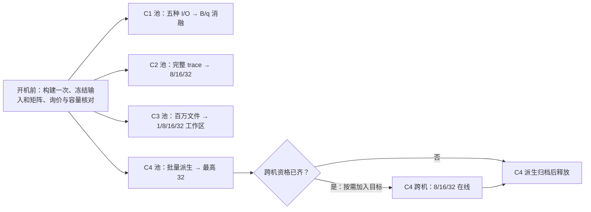

# 阿里云正式规模实验：32 Agent 主档，按需扩展

目标：测量云上 Agent 集群在并发回放、共享数据、批量派生和跨机流转时，BrewFS 的设计能否降低任务完成时间、尾延迟和后端开销，以及优势在哪个负载档消失。外部对照只用 JuiceFS；同一机制的开关在 BrewFS 内另做配对。历史 10 万文件 pilot 只用于验证脚本、估计准备时间和找容量瓶颈。

现有 `main` 模板已能生成 **330 个系统单元**（C1/C2/C3/C4 为 30/180/24/96）和独立的 **66 个消融单元**，含三个配对重复。它的 C2 最高 8 Agent、C3 仍是单 Agent、C4 最高 64 个派生或 32 个在线 Agent，**不足以执行下文所有大规模条件**。保留原模板和历史状态；用独立 campaign 登记扩展条件，不覆盖已冻结计划。

## 资源复核与执行档位

**本轮并发上限 32 Agent，正式主档 8 → 16 → 32。** 保留百万文件、完整 trace、同档配对和正式重复。64、128 不进入本轮采购和执行队列；下表仅保留规模对比。C1 与规模曲线分开，不随 Agent 档位扩容。实际选址、完整盘价和 C2 节奏见[32 Agent 落地手册](MAIN-C2-COST-DISKS.zh.md)。

2026-11-11 杭州 J 区只读检查：16/32 vCPU 的 g7 和 u1 候选规格返回 WithStock；库存接口不承诺可一次申请的台数。现有私网交换机剩余 IP 充足，企业级按量专项 vCPU 额度未返回有效数值，开机前须在配额中心核实。按 g7、每台 40 GiB PL0 系统盘实询，32/16 vCPU 分别为 ¥8.41 / ¥4.23 每小时。用每池 1 Redis + 4 RustFS、每客户端 8 槽计算：

| Agent 档 | 单池客户端 | 单池实例 / vCPU | g7 单池每小时 | 两个同档池每小时 |
|---|---:|---:|---:|---:|
| 32 主档 | 4 | 9 / 208 | ¥54.79 | ¥109.58 |
| 64 不排 | 8 | 13 / 336 | ¥88.43 | ¥176.86 |
| 128 暂不排 | 16 | 21 / 592 | ¥155.71 | ¥311.42 |

费用只含实例和系统盘，不含数据盘、额外目标机、跳板、OSS 和网络；不是总账单。默认在一个正式池上做同池配对；若确实要压工期，再按独立就绪队列开第二池，不默认同时开两个峰值池。当前低规格 pilot 节点不能直接按每台 8 槽使用。复跑可参考 [ECS 库存接口](https://www.alibabacloud.com/help/en/ecs/developer-reference/api-ecs-2014-05-26-describeavailableresource)和 [ECS 配额](https://www.alibabacloud.com/help/en/ecs/user-guide/limitations)。

## 负载、对照和交付指标

| 队列 | 正式工作量 | 对照与可归因设计 | 首要指标 |
|---|---|---|---|
| C1 I/O 基线 | 5 种 fio，8 jobs；顺序每单元测 32 GiB，随机工作范围 32 GiB、实际测 2 GiB；保持同步语义 | BrewFS flat vs JuiceFS；BrewFS 内分别单变量测对象大小、持久化 B 和校验粒度 q | 吞吐、IOPS、操作与 fsync P99、后端物理读写字节、请求数 |
| C2 真实 trace 并发 | 保留现有 4 份完整 trace 的低并发对照；同质 pytest 全量回放跑 **8/16/32 Agent**；32 另做冻结混合批次和错峰对照。每 Agent 一个完整任务、独立可写工作区。两边使用同一 trace 清单、比例、启动顺序和输入摘要 | BrewFS 候选路径 vs JuiceFS；对照已合格的 BrewFS flat，解释总体差距；每个写入路径需独立验证同一命名空间的最终状态 | 完成任务/分钟、整批完成时间、分 trace 的任务延迟、失败数、每任务对象请求/字节与 CPU 秒 |
| C3 百万小文件共享 | 每组使用同一份 **100 万 × 4 KiB** 基线，**1/8/16/32 个工作区**，每个 Agent 执行相同的冷读、热读、首次 COW 和后续读写序列；热集合保留 1,024 / 16,384 两档 | Packed vs JuiceFS 和已合格的 flat；同一 Packed 路线 cache on/off；只有同引擎且布局、缓存匹配才做纯 Packed 格式归因 | 各阶段延迟、完成工作区/秒、每新增工作区的物理空间和上传字节、缓存和元数据请求、父子隔离 |
| C4 批量派生 | 独立的百万文件基线；同时发起 **1/8/16/32** 个派生，之后各自首读、修改并同步 | BrewFS 候选 vs JuiceFS 原生 clone；flat 全拷贝用于说明实际完整复制成本；同引擎的共享 Delta/完整物化另做单变量对照 | 从请求到首次正确读取的 P50/P95/P99、批次最后一个就绪时间、上传和物理空间、父子隔离 |
| C4 跨机流转 | **8/16/32** 个真实 OpenCode checkpoint，对应迁移 **2/4/8** 个；其余 Agent 继续运行。保持一组 stay，同批输入和节奏。全部核状态重开和写者接管；按事先登记的子集发真实 resume 请求 | BrewFS 与 JuiceFS 的 stay/move 分别配对；单列各自实际写者保护机制和故障结果，不能把协调端保护算成文件系统原生 fencing | 源端停止到目标可读、可写、首个新工具事件的时间，丢失/重复操作和旧写者拒绝；未迁移邻居吞吐变化。模型等待单列 |

- **同一并发档比较两个系统；同一系统跨档才看扩展。** 固定后端池、镜像、耐久设置和每 Agent 限额；只增加客户端及其 Agent。确认出现饱和后另做后端扩容曲线，单独报告，不能在主曲线中途加 Redis 或对象节点。
- **正式重复按整个批次计**。每个主条件预登记 3 个配对批次；主结论所依赖的 32 档和预先指定的饱和边界做 5 对。按轮次配对，交替或随机平衡产品顺序；保留失败、未准入和超时。按轮汇总，再估不确定性；不能把同轮 32 个 Agent 当成 32 次独立实验。低并发分位数附样本数；单次迁移和模型请求不报稳定 P99。
- **大档位准入**：每个档位先核满员实际绑定、版本、工作量和采集，再准入计时。要求每 Agent 有独立路径、日志和退出证据，实际并发达到预设；校准不通过或发生数据错误不得开始下一档。吞吐饱和但正确性仍通过时，记录该档并按预登记顺序继续，避免选择性报点。已知发布、重挂写入或 native lower 容量限制的路线保留失败，不能换数据量、换方法或只核少量文件冒充通过。

## 每条队列交给执行 Agent 的任务卡

| 队列 | 启动前固定 | 实际步骤 | 每轮过关证据 |
|---|---|---|---|
| C1 | fixture SHA、fio job/seed、顺序和随机范围、fsync/缓存/耐久选项；五种模式分别配对 | 导入并验 CRC → 冷挂 → 校准 → 一次 fio → 排空 → 重挂验 CRC | fio 每 job 字节/延迟分布、对象请求与 B/q、源盘和后端盘指标、原生关闭回执 |
| C2 | 完整 events/blob/初始树 SHA、Agent→trace/节点/路径、偏移表、回放 flags；错峰不替代同步峰值 | 每台分发一次输入 → 各 Agent 独立工作区 → ready barrier → 一次完整回放 → 排空和最终状态验证 | 每 Agent 实际回调/读写字节、首次失败及序号、树/链接/权限/数据库、开始偏差和实际并发；所有失败也保留 |
| C3 | 百万文件独立清单、共享父版本、热文件序列、每 Agent 的独立 child、两档热集合；不混用 C4 fixture | 一次父目录全量核验 → 同步释放工作区 → 冷读、预热、热读、首次修改和后续读写 → 排空 → 验父与各 child | 每阶段独立计时，按实际触及文件验证全量修改，最终正式证据绑定父版本和完整命名空间；同步记物理空间、GET/PUT/缓存计数 |
| C4 派生 | 百万文件独立父目录、固定首读与修改序列、children 数；每种方法写明是真 clone 还是完整拷贝 | 父版本持久化 → 并发发派生请求 → 首次正确读取 → 修改及 fsync → 排空 → 冷重挂验父和 child | 各 child 就绪时刻及首读 SHA、全批 wall、失败/隔离、对象写放大和每盘峰值 |
| C4 流转 | 源、目标、真实 checkpoint SHA、stay/move、迁移名单及旧写者探测、真实 resume 子集 | 邻居先进入稳态 → 固定触发停止源 → 目标冷重开验证会话 → 申请写权限 → 验旧写者失败 → 执行接续 | 只在实证时报告旧写者拒绝、目标工具完成、无丢失/重复；分开存储停顿、模型等待及邻居基线 |

控制台以外再保留一个机器可读索引：每个 cell 的配置和输入摘要、位置、资源、开始和结束、原档位置与 SHA、正确性状态、失败原因及计费时段。消融只变一个已验证开关；没有同引擎等价对照时报告系统对比，不给出纯机制归因。提前登记全部主档及配对次数，避免只挑有优势的一档出图。

## 按需资源与并行排程

正式池的规划起点：客户端 **32 vCPU / 128 GiB**，每台先排 **8 Agent**，每 Agent **2 vCPU / 8 GiB、无 swap**，留一半给内核、FUSE、采集及突发。每个独立池用 **1 个 Redis 节点**和 **4 个独立 RustFS 节点**，每对象节点暂按 **4 块独立数据盘**估算；Redis 先按 16 vCPU / 64 GiB、对象节点按 16 vCPU / 64 GiB 询价，最终以容量与负载实测冻结。所有池尽量同地域/可用区、同实例及盘规格。Redis 高可用、跨可用区和 RustFS 故障恢复另立实验，不混入吞吐对照。单台四盘的 pilot 不能当作四节点性能依据。

| 队列最大档 | 源客户端 | 目标客户端 | Redis | RustFS | 私网实例 |
|---|---:|---:|---:|---:|---:|
| C1 8 fio jobs | 1 | 0 | 1 | 4 | 6 |
| C2 32 Agent | 4 | 0 | 1 | 4 | 9 |
| C3 32 工作区 | 4 | 0 | 1 | 4 | 9 |
| C4 32 派生 | 4 | 0 | 1 | 4 | 9 |
| C4 32 在线、8 迁移 | 4 | 1 | 1 | 4 | 10 |

实例数是假设每台 8 个合格槽后的规划值。低档只开所需客户端：8/16/32 对应 1/2/4 台；跨机目标按同时迁移数另算。在同一规模的配对内不变更实际节点。每个池一次只测一个单元，组间只有在服务、盘、客户端、采集及实际网络瓶颈独立时才能同时计时。每池使用自己的 Redis、RustFS 和采集器；整批复用一台跳板和协调者，保留一个公网入口。

**默认单池，按需加第二池**：先跑 C2 的 8/16/32；在 C2 执行时并行准备 C1、C3、C4 的输入与资格。只有第二条队列就绪且有工期需求才开第二池，优先让 C1 与 C2 并行（各自主档峰值合计 15 台），之后可换 C3 或 C4。C4 派生和跨机在同一池分时，跨机目标只在实际需要时启动。每池归档验完就独立释放。

## 容量、可观测性与交接

1. **先算空间和时间再定盘**。C4 的 32 个完整副本加父目录，仅逻辑数据就是 **135.168 GB（约 126 GiB）**，未计纠删码、对象封装、元数据、校准、正式轮次和失败现场；C3/C2 同理。每池核实际盘和 Redis 的峰值，按最满的单盘、inode 和最坏臂估算，至少留 20% 余量。若保留多轮副本，按峰值叠加；只有已经核验归档且确认清理的副本可从容量预算扣掉。不要从 100k 的时间线性外推到百万 × 32。
2. **计时和计费分开**。每轮记录开机、导入、校准、正式计时、排空、冷验、归档及释放；费用按实例/云盘真实占用小时，再加网络、OSS、跳板。先比较两池和四池各自的完工时间及池小时，当前价格用 `cloud.py quote` 的适用规格或实际询价回执。旧三节点 pilot 单价不适用于四节点正式池。
3. **采集随节点扩展**。每客户端、Redis 和四个对象节点保存原始指标和统一阶段标记。每 Agent 记 barrier 就绪、起止、逻辑字节与错误；每宿主记 cgroup、CPU、内存、磁盘与网卡；Redis 记命令、延迟、内存与持久化；RustFS 记每节点请求、字节、校验和磁盘负载。校准沿用 5 秒采样、最长 30 秒间隔和 5% 开销门槛；大档位保留时钟偏差及各节点观测完整性。采集原档先写节点专用路径，避免计时窗口内通过跳板集中压缩和上传。恢复和归档时间不从账单扣除。
4. **开机前交给 Agent 的文件**：本批 `config.json`、`plan.json`、`sizing.json`、`drafts/queues.json`、每池真实 inventory、版本/输入摘要及报价。现有通用 planner 和单步协议见[执行入口](README.md)。扩展档先验证多客户端 barrier、C3 并行工作区 runner、四节点观测与跨机拓扑；现有 pilot 的 A/B 启动器和三角色采集配置不能直接拿来跑此表。只有通过真实挂载、冷读、容量、故障关闭及观测检查的路线，才进对应正式队列。具体并行资源锁与交接见[调度手册](pilot-aliyun/REPEAT-SCHEDULING.zh.md)。
