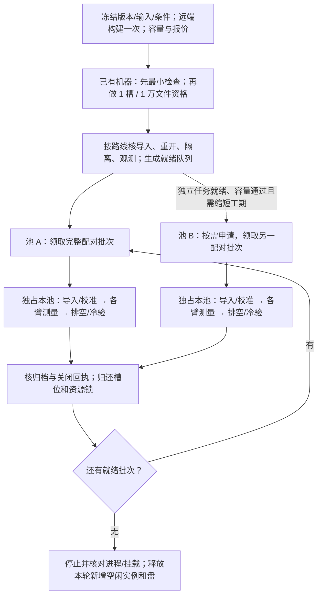

# C1–C4 并行流程与按需资源

实验参数见 [design.json](current/design.json)，负载见[测试方法](current/WORKLOADS.zh.md)。本页统一规定调度和资源生命周期。

实际分工与命令见 [8 个实验块](current/BLOCKS.zh.md)。一个实验块可含多个输入/规模条件；下文的 block 特指一次重复的完整对照组，两者不能混为同一个调度粒度。最小运行器按块串行检查功能，不是正式并行调度器。

## 排程单位

- **一次冻结运行（campaign）**：一套源码产物、输入、配置和执行清单。开头取最新分支，所有重复和扩展曲线固定版本；升级另开 campaign。
- **配对批次（block）**：一个条件、一次重复的全部系统臂。分配给同一池，按预登记顺序依次执行，完成后才换条件。
- **单元（cell）**：其中一个系统臂的一次完整测量。一个池同时只运行一个 cell。
- 默认一池，最多两池。**两池正在运行的负载合计 ≤32 槽**；C1 的 8 个 fio jobs 合占 1 槽。迁移目标替换源 Agent，源停止后才运行目标，额外目标机器计入资源账单。

第二池领取另一完整配对批次；不按“BrewFS 一池、JuiceFS 一池”拆分对照。同一扩展曲线优先留在同池；换池须核硬件/盘/网络等价并单列 pool ID。新调度器须实现全局槽位计数，当前旧状态库尚未强制这一规则。

## 从准备到释放

图表示依赖关系，不承诺耗时。C1/C2/C3/C4 没有固定串行依赖：输入及该路线验证通过即可入队。缺少 Pack-off 适配只阻断对应消融；缺少迁移验证只阻断 C4 迁移。尚未通过的条件保留失败/待实现记录。

| 阶段 | 启动条件 | 同池占用与完成证据 |
|---|---|---|
| 准备 | 源码/输入身份已定 | 远端构建；生成预期树、容量与报价；无需先开全部测试节点 |
| 导入与校准 | 本池空闲、全部所需盘可用 | 登记 importer PID；一次完整基线校验；observer 开/关至少 3 对 |
| 配对测量 | 本 block 全部臂可执行；槽位/资源锁可用 | observer 就绪 → 挂载和 barrier → 一次负载 → 排空 → 关闭 → 冷重开验证 |
| 批次收尾 | 各臂退出，证据停止写入 | 核完整结果、counter/阶段覆盖、两次零债务、原进程退出、mount 消失 |
| 换条件/释放 | 归档逐文件 SHA 验证通过 | 归还锁；有就绪任务继续，否则释放新增空闲节点及盘，保存云 API 确认 |

校准 off 仅运行该校准步骤；正式测量必须启用 observer。每个 cell 新建 upper/缓存，复用已经验证且格式/布局一致的只读基线。切换 dynamic 布局时独占整个池，所有对象节点使用相同配置并建立新对象前缀。

## 两池怎样并行

| 池 A | 池 B | 是否可同时测量 |
|---|---|---|
| C2，16 Agent | C3，16 Agent | 可以，总计32槽，后端与盘独立 |
| C4 派生，16 Agent | C1，8 fio jobs | 可以，总计17槽，分别完成自己的系统配对 |
| 任一32 Agent条件 | 任一额外负载 | 不可以；另一池只做不争用资源的准备/离线分析 |
| 同一 Redis/RustFS 或同一物理盘 | 另一个 case | 串行，统一 resource ID |
| 任一测量 | 共用跳板/NIC 上大批下载、归档上传 | 避开测量窗；小型控制消息正常发送 |

每池独占客户端、metadata、4 个 RustFS 宿主及其盘。网络瓶颈也登记 resource ID，不能仅凭不同容器/IP 判定隔离。准备与校验只有在 CPU、盘和链路不与测量争用时并行；需要大批传输时，在两池测量之间安排传输窗口。原始观测先写节点本地，不能边测边集中压缩上传。

两池后端固定开销较高；只在另一条队列已就绪、能缩短完工时间时申请。32 档测量期间，未有下一就绪任务的第二池不空等。

## 节点与云盘

| 每池阶段 | 源客户端 | 目标 | Redis | RustFS | 业务节点合计 |
|---|---:|---:|---:|---:|---:|
| C1 或 ≤8 Agent | 1 | 0 | 1 | 4 | 6 |
| 16 Agent | 2 | 0 | 1 | 4 | 7 |
| 32 Agent | 4 | 0 | 1 | 4 | 9 |
| 32 在线、迁移8个 | 4 | 1 | 1 | 4 | 10 |

客户端/目标 32C128G，每台8槽；Redis/RustFS 各16C64G。每台系统盘40 GiB PL0；客户端数据盘100 GiB PL1、Redis 60 GiB PL1、RustFS 每台4×120 GiB PL1。目标只在迁移阶段申请；全部池共用一个公网跳板/协调者。容量按[详细配置](current/CONFIGURATION.zh.md)逐盘核算。

两池各16 Agent需14台业务节点、288 vCPU、1,152 GiB RAM，另计跳板；比一个32档池的9台/208 vCPU贵。历史报价见[成本页](MAIN-C2-COST-DISKS.zh.md)，建机前重新询价，按池小时、逐盘小时、目标与网络核账。

运行交接记录 pool/owner/block/cell、阶段、PID/boot ID、输出路径和下一单步操作。未知/started 步骤先核原进程，不自动重试；失败现场归档后登记新 attempt，保留失败样本。确认没有活动挂载、任务或依赖资产后才能释放；停机和脱盘不等于费用终止。
