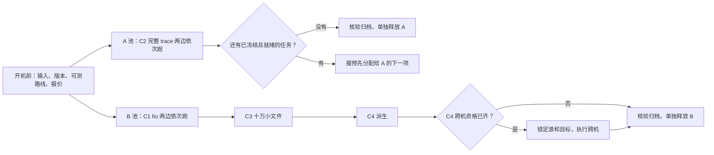

# C1–C4 按实验并行：两池起步，四池按需扩展

> 历史协议，仅用于原冻结计划；新实验见[当前方案](../current/README.zh.md)。

C1 fio、C2 完整 trace、C3 小文件和 C4 派生没有跨实验的数据依赖，可以同时跑。此前 C4 做完才启动 C2，是因为两项占同一组机器。复跑时先决定按**实验**分池还是按**产品**分池，再绑定实际实例、磁盘和服务。不要给同一批机器多起几个池名来制造并行。

| 排法 | 同时运行 | 新增私网机器上限，不含既有跳板 | 适用条件 |
|---|---|---:|---|
| 单池 | 一个测量单元 | 3 | 只有一个队列就绪，或成本优先 |
| **两池，按实验分** | 例如 A 跑 C2，B 先跑 C1 再跑 C3/C4；两边各自在本池内顺序跑 BrewFS 和 JuiceFS | 6 | **建议先试这个排法**。一个长任务不堵其他实验，同一对照用同一组硬件 |
| 两池，按产品分 | 同一实验两边同时测，或各自跑下一个已就绪单元 | 6 | 优先尽早拿到某项配对；须验证跨池硬件，报告标明池别 |
| 四池，按实验分 | C1、C2、C3、C4 派生各一池；同一实验内对照仍顺序测 | 12 | 四条队列都已就绪、两池赶不及、地域配额与成本允许 |

C4 **跨机会话流转**和 C4 派生是两条队列。跨机单元需额外一个客户端时优先借已空闲的合格节点，并为本次流转锁定源、目标、后端和采集器；借不到才短开一台目标机。若四池都在跑，不抢另一池的客户端，也不在 C4 派生的同一个 Redis/RustFS 后端上同时做跨机测量。会话 checkpoint 或真实 resume 未通过资格时，不为它留计费节点。

## 两池排程示例

这是排程顺序，不是开始时间承诺。每个方框包含本池必要的资格、校准、正式计时、冷验和归档。哪条队列就绪先跑哪条；C2 慢不影响 B 的推进。

队列里记四种依赖：**输入/资产、资格、资源占用、同一条件的结果汇总**。汇总依赖不挡测量；例如 C2 的 BrewFS 与 JuiceFS 都验收后才算成对结果，但无需同时开跑。C1 结束也不是 C3 的资格。每项按实际资源独占；准备和冷验同样占机器，校准关/开两侧都不夹带其他任务。物理共享的网卡、网络限额、对象后端和归档通道如可能成为瓶颈，正式计时需错开，或先用短探针证明互不干扰。

## 配置、开机和费用

- **配置方式**：通用 planner 按集群的 `supported_suites` 过滤。四池可用 `pool-c1` 至 `pool-c4`，各只支持对应 C 编号；`baseline-parallel` 下将两个产品都映射到这四个池名，planner 会把每个 cell 放到支持它的唯一池。同一实验内仍逐 cell 独占。两池示例给 A 配 `[C2]`，B 配 `[C1,C3,C4]`，两个产品都映射到 A/B。C4 fork 和 handoff 分别冻结实际角色与阶段；只有 handoff inventory 包含目标。生成草稿后核对 `cell_pools` 和`queues.json` 中的各池队列，确认实际分配和预期一致。
- **当前脚本边界**：`configure-pilot.py` 默认只接单池或按产品分的 `pool-a/pool-b`。按实验放置用通用 planner 的显式配置，执行前再确认各阶段 runner 支持该 pool 名和拓扑。需要多个阶段状态库时，锁目录必须指向同一协调者的物理锁根，实际共享的资源 ID 不能改；独立池用不同 pool ID，以免锁名碰撞。旧脚本只认 A/B 时先补绑定并验证，不能直接拿四池草稿开机。
- **资源时间表**：每个池记录最早就绪时间、预计从创建到可释放的时长、小时报价、任务负责人和归档出口。两池优先，先把预测最长的就绪队列放入一个池，另一池填就绪任务；四池仅在就绪队列多、两池预计赶不及且配额足时开。各池可以晚开、先结束先释放。新出现的任务如果要换池，须生成新放置并通过实际资格，不移动已领取的 cell。
- **成本例子**：按历史报价每池 ¥4.566/小时，三节点池两组同时开约 **¥9.13/小时**，四组约 **¥18.26/小时**；不含协调盘、跳板、目标机、OSS 和网络。比较的是各组从创建到释放的时间之和。四池各占 1 小时，与两池各占 2 小时，池资源都约 **¥18.26**；若四池多了重复导入、空等或资格验证，就可能更贵。用本批询价和时长预算替换这些示例。
- **启动门槛**：实际版本与输入摘要已冻结、待跑路线已通过开机前可行性检查、资源账本明确属于本批。每池完成本池资格后才测量。某项失败只阻断依赖它的项；原挂载、进程和租约确实清理后，其余已就绪任务可继续。已阻断且无后续任务的池归档后释放，不为凑满 28 项等产品修复。

执行、证据和计费字段沿用[复跑手册](REPEAT-SCHEDULING.zh.md)；并行配置见[通用 planner](../12-parallel-baselines.zh.md)。已在本机用通用 planner 检查两种放置：都生成 28 个单元，C1/C2/C3/C4 分别为 10/5/4/9。校验使用占位硬件，未绑定实际资源，不能作为云上运行资格。
