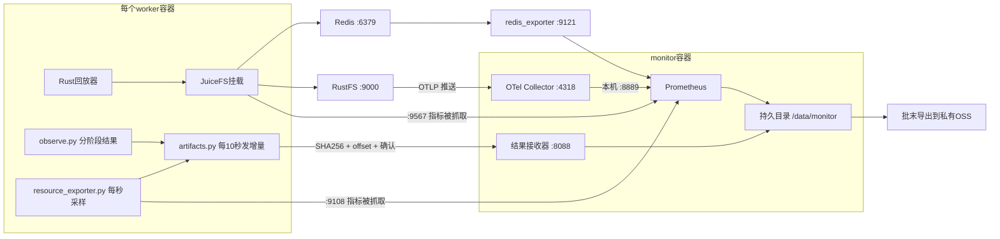

# 指标收集架构

## 1. 进程和数据流



Redis、RustFS、monitor也各运行一份resource_exporter和artifacts发送器。Prometheus按实际IP静态抓取，不访问Kubernetes API。[配置生成器](deploy/render.py)输出Prometheus和OTel配置；启动命令见[部署](deployment.md)。

## 2. 频率、保存位置和关联字段

| 数据 | 频率/时点 | 保存位置 |
|---|---|---|
| cgroup、网络命名空间原值 | 每1秒；一容器一份 | 本地resources.jsonl，10秒内增量送monitor |
| JuiceFS客户端指标 | Prometheus每1秒抓取 | monitor独立TSDB |
| RustFS指标 | 每1秒OTLP推送，Prometheus每1秒抓Collector | 同上；带service_name区分s0…s3 |
| Redis指标 | 每5秒 | 同上；不扫key、不采每条命令日志 |
| 准备/回放/校验结果、错误码 | 每阶段结束；过程资源每1秒 | 每任务目录，增量送monitor |
| 指标原始快照 | 批次屏障前、所有任务结束后；后台尚在写时另记结束窗口 | before/after.prom，保留原标签 |
| 软件、配置、输入摘要、任务计划 | 开跑前一次 | campaign清单；只存摘要与无密钥配置 |
| 协调器事件 | 每次提交、ready、发令、结束、超时 | coordinator-events.jsonl；协调器待接入 |

共同标识：campaign、system、repeat、task_id、worker_id、容器分配ID；Pod/节点ID已知才填写。Prometheus的worker由静态配置标注；campaign以独立TSDB目录和计划关联，external_labels不用于假定本地查询会自动出现该标签。系统切换和任务边界以事件时间范围关联，不给每条I/O加任务标签。

## 3. 需要记录的指标

| 指标 | 来源/字段 | 怎么算、不能混淆什么 |
|---|---|---|
| 成功/失败/超时/缺结果 | 原计划＋case-result＋协调器 | 分母来自计划，失败不删，缺耗时填null |
| 排队、批次时间、迁移暂停 | 同一协调器单调时钟 | worker本地阶段时间独立算；不跨机器相减monotonic_ns |
| 准备/回放/终检时间 | observer-result.wall_seconds、replay.execution_seconds | 回放含解析/哈希/路径检查，不是纯syscall时间 |
| 操作次数、实际读写byte | replay.operations / actual_read_bytes / actual_write_bytes | 与metrics.json核对；不是磁盘IOPS或网卡流量 |
| 重复读取比例 | 原metrics.repeated_read_ratio | 同文件身份/区间在覆盖前重复读取的字节占比；不是缓存命中率 |
| CPU核秒、限流 | ax_cpu_seconds_total、ax_cpu_throttled_seconds_total、ax_cpu_periods_total、ax_cpu_throttled_periods_total | 前后差值；限流周期比例=Δthrottled_periods/Δperiods |
| 内存、OOM | ax_memory_current_bytes、ax_memory_limit_bytes、ax_memory_events_total | 采样峰值和oom_kill增量；lifetime memory.peak只留原值 |
| 可归属块I/O | ax_cgroup_block_bytes_total、原io.stat | 按设备读写增量，不等于远端RustFS物理盘读写 |
| 网络 | ax_netns_bytes_total，原/proc/self/net/dev | 去loopback；同Pod网络只计一次；收发不相加冒充有效数据量 |
| JuiceFS请求延迟 | juicefs_fuse_ops_durations_histogram_seconds的bucket/sum/count | 客户端FUSE处理延迟，保留operation标签；合并桶再求p95，不平均各容器p95 |
| JuiceFS元数据 | juicefs_transaction_durations_histogram_seconds、juicefs_transaction_restart | 事务耗时/重试；不是原trace的getattr次数 |
| JuiceFS对象请求 | juicefs_object_request_durations_histogram_seconds、juicefs_object_request_data_bytes、juicefs_object_request_errors | 按method分GET/PUT/HEAD/DELETE；count、byte、失败分别报 |
| JuiceFS缓存 | juicefs_blockcache_hit_bytes/miss_bytes、hits/miss、bytes | 固定缓存预算后比较；不能用trace重复读比例代替 |
| JuiceFS空间/inode | juicefs_used_space、juicefs_used_inodes | 文件系统层占用；不当RustFS冗余后物理占用 |
| Redis | redis_memory_used_bytes、redis_connected_clients、redis_commands_processed_total、AOF状态/大小 | 保存版本与原始指标；持久化模式和rewrite发生时间同时记录 |
| RustFS | OTLP实际导出的请求/错误/字节、scanner/heal、readiness，另加容器资源 | 先保存实际指标名称与HELP；未导出的值null，不能捏造GET物理读取量 |
| 设计消融 | BrewFS元数据请求、索引读量、上传byte、对象/范围布局 | 开关真正改变实现后再测；没有相应计数，不解释具体机制收益 |

JuiceFS名称来自[CE指标文档](https://juicefs.com/docs/community/reference/p8s_metrics/)，开跑前保存1.4.2实际`/metrics`并核对字段与标签；缺字段记null，不用相似字段顶替。RustFS以实际OTLP输出为准。[RustFS指标说明](https://docs.rustfs.com/en/operations/observability)

## 4. 采集质量检查

- `up`全部为1且实际指标在更新；`time()-ax_sample_timestamp_seconds`持续超过5秒时本批标记采集异常。
- RustFS的up只表示Collector端口可达；配置将停止推送的指标在15秒后过期，必须同时检查各RustFS服务的实际指标是否仍存在。没有请求时计数不增长不等于采集失败。
- 资源exporter只解析自己的cgroup。`ax_source_available=0`表示读不到，相关数值指标不输出。自己的cgroup边界仍需与平台容器范围核对。
- 同一容器的exporter总量包含回放、FUSE、日志发送等进程。observe的阶段快照用于定位，不能再累加一次同一cgroup。
- 计数重置、进程重启、日志缺口单独记录。SIGKILL后的缺结果由外部计划保留；退出137不独自证明OOM。
- 三批列原值和中位数/范围；先做采集开/关配对，开销超过5%时调整频率后统一重跑。只关采集，不关内容校验。
- 输入/blob/输出日志放在JuiceFS被测目录外；每秒不做全目录du/find。RSS、io.stat、du都不能代替后端物理占用。

每批开始和结束各保存一次原始指标。BATCH取计划中的run_id；同一批的PHASE分别为before、after，不覆盖上批文件：

```bash
export BATCH=smoke-juicefs-w2-c4-r1
export PHASE=before
export SNAP=/measure/$CAMPAIGN/batches/$BATCH
mkdir -p "$SNAP"
# 各worker执行：
curl --fail --max-time 5 "http://$SELF_IP:9567/metrics" > "$SNAP/juicefs-$PHASE.prom"
# redis容器执行：
curl --fail --max-time 5 "http://$REDIS_IP:9121/metrics" > "$SNAP/redis-$PHASE.prom"
# monitor执行：
curl --fail --max-time 5 http://127.0.0.1:8889/metrics > "$SNAP/rustfs-$PHASE.prom"
```

只执行所在角色的命令。失败的快照不能作为零计数；取数时点记录在批次事件中，RustFS推送延迟和尾部写入单列窗口。每份快照会被artifacts发送。总请求量用同一实例前后counter差值，重启时分段；延迟分位数合并同操作的histogram桶计算。Prometheus的原始TSDB一起保存，不能只留下rate曲线截图。

## 5. 日志与结果保留

artifacts.py发送文件白名单中的资源、任务结果、stdout/stderr、清单和指标快照。每次POST含文件相对路径、offset、1 MiB以内内容和SHA256；接收端仅追加或核对同一块重试，冲突返回409。源文件截断/改写须开新attempt。10秒上传周期内尚未传出的数据可能随容器丢失；monitor保存已收到范围，缺尾部不会补成成功。

接收目录：`/data/monitor/results-$CAMPAIGN/<worker>/<原相对路径>`。monitor持久卷也需要批末外部备份。全部worker完成最后一次`ship --once`后，逐文件对照大小与SHA256；软件服务原始日志若不在发送白名单，另通过平台入口拷贝到同批目录。

Prometheus仅监听localhost；为批末快照，在启动参数中启用`--web.enable-admin-api`。在monitor执行：

```bash
mkdir -p /data/exports
SNAPSHOT=$(curl --fail -X POST http://127.0.0.1:9090/api/v1/admin/tsdb/snapshot \
  | python3 -c 'import json,sys; print(json.load(sys.stdin)["data"]["name"])')
tar -C /data/monitor -czf /data/exports/$CAMPAIGN.tar.gz \
  results-$CAMPAIGN tsdb-$CAMPAIGN/snapshots/$SNAPSHOT
sha256sum /data/exports/$CAMPAIGN.tar.gz > /data/exports/$CAMPAIGN.tar.gz.sha256
aliyun oss cp /data/exports/$CAMPAIGN.tar.gz \
  oss://brewfs-agent-traces-20261023-4ccdae73/k8s-results/$CAMPAIGN/results.tar.gz \
  --endpoint https://oss-cn-hangzhou.aliyuncs.com --acl private
aliyun oss cp /data/exports/$CAMPAIGN.tar.gz.sha256 \
  oss://brewfs-agent-traces-20261023-4ccdae73/k8s-results/$CAMPAIGN/results.tar.gz.sha256 \
  --endpoint https://oss-cn-hangzhou.aliyuncs.com --acl private
```

下载核验远端包后才释放本批容器。源代码版本、归档SHA256、实际容器映射、配置和所有失败任务必须一起保留。这个导出步骤是执行说明，本轮尚未向OSS上传新结果。
